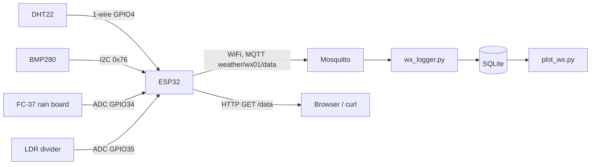
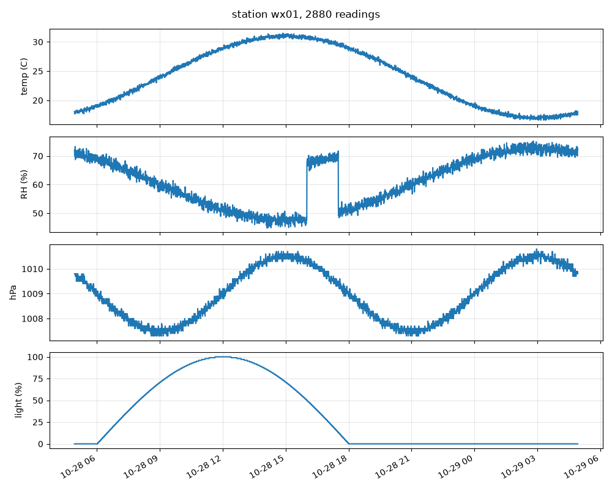

# iot-weather-station

A small weather station on an ESP32. It reads temperature, humidity,
pressure, rain and light every 30 seconds, publishes the reading as JSON over
MQTT, and also serves the latest reading on a tiny HTTP endpoint. A Python
script on the PC subscribes to the topic, stores everything in SQLite and
plots it.

This is a rebuilt and cleaned up version of my B.Tech project at Anurag
Group of Institutions (now Anurag University). The original was one big
Arduino sketch. Here the sensor math and JSON packing are split into plain C
so they can be unit tested on a PC, and there is a simulator so the PC side
can be run without the board. I don't have photos of the original hardware,
so none are included.

## Block diagram



## Hardware

- ESP32 DevKit v1 (ESP32-WROOM-32)
- DHT22 temperature / humidity sensor + 10k pull-up
- BMP280 pressure sensor, I2C (sold as "BME280" in many shops, see notes)
- FC-37 / YL-83 rain board with the LM393 comparator module (analog out used)
- LDR + 10k resistor as a voltage divider
- 5 V USB supply

## Wiring

| Part        | Pin on part | ESP32 pin | Notes                                  |
|-------------|-------------|-----------|----------------------------------------|
| DHT22       | VCC         | 3V3       |                                        |
| DHT22       | DATA        | GPIO4     | 10k pull-up to 3V3                     |
| DHT22       | GND         | GND       |                                        |
| BMP280      | VCC         | 3V3       |                                        |
| BMP280      | SDA         | GPIO21    |                                        |
| BMP280      | SCL         | GPIO22    |                                        |
| BMP280      | SDO         | GND       | address 0x76                           |
| Rain module | AO          | GPIO34    | ADC1, input only                       |
| Rain module | VCC / GND   | 3V3 / GND |                                        |
| LDR divider | middle      | GPIO35    | LDR to 3V3, 10k to GND                 |

The analog sensors are on ADC1 pins on purpose. ADC2 can't be used while
WiFi is on.

## Repo layout

```
lib/wx_core/      plain C: validation, dew point, rain level, JSON packing
src/              ESP32 firmware (Arduino framework, PlatformIO)
host/wx_json.c    PC tool that runs wx_core on text input
host_tests/       C unit tests for wx_core
tools/            wx_logger.py, sim_station.py, plot_wx.py
tests/            pytest tests for the Python side
```

## Message format

Topic: `weather/<station id>/data`

```json
{"id":"wx01","temp_c":24.3,"humidity":55.0,"pressure_hpa":1008.2,"dew_point_c":14.7,"rain":"dry","rain_raw":4000,"light_pct":50,"uptime_s":120}
```

If a sensor read fails (the DHT22 returns NaN now and then) the field is sent
as `null` instead of a fake number, and the logger stores it as NULL.
The station also publishes `online` / `offline` (MQTT last will) on
`weather/<id>/status`.

## Build and flash the firmware

Needs PlatformIO (`pip install platformio`).

1. Create `src/secrets.h` (it's in .gitignore):

   ```c
   #define WIFI_SSID "my-wifi"
   #define WIFI_PASS "my-password"
   #define MQTT_HOST "192.168.1.10"
   ```

2. Build and flash:

   ```
   pio run
   pio run -t upload
   pio device monitor
   ```

Build output on my machine (no board connected, compile only):

```
RAM:   [==        ]  15.1% (used 49640 bytes from 327680 bytes)
Flash: [========  ]  82.6% (used 1082048 bytes from 1310720 bytes)
======================== [SUCCESS] Took 104.82 seconds ========================
```

Most of the flash is the WiFi stack, not this code.

## Run the tests

C tests (no hardware needed):

```
$ make test
cc -std=c99 -Wall -Wextra -Werror -O1 -g -Ilib/wx_core host_tests/test_main.c lib/wx_core/wx_core.c -o build/test_wx_core -lm
cc -std=c99 -Wall -Wextra -Werror -O1 -g -Ilib/wx_core host/wx_json.c lib/wx_core/wx_core.c -o build/wx_json -lm
./build/test_wx_core
25 checks, 0 failed
```

Python tests (one of them runs `build/wx_json`, so run `make` first):

```
$ pip install -r requirements.txt
$ python3 -m pytest -q tests
..........                                                               [100%]
10 passed in 0.03s
```

## Run it without hardware

The simulator prints readings in the same JSON format as the firmware. The
temperature follows a day/night curve and there is a short rain shower in
the afternoon.

```
$ python3 tools/sim_station.py --hours 24 | python3 tools/wx_logger.py --stdin --db weather.db
stored 2880 readings, skipped 0 bad lines
$ python3 tools/plot_wx.py --db weather.db
wrote weather.png (2880 readings)
```



With a broker running (`mosquitto -v`), the same thing goes over MQTT:

```
python3 tools/wx_logger.py --mqtt localhost --db weather.db
python3 tools/sim_station.py --mqtt localhost --realtime
```

You can also check what the C code produces for given raw values:

```
$ echo "24.3 55 1008.2 4000 2048 120" | ./build/wx_json
{"id":"wx01","temp_c":24.3,"humidity":55.0,"pressure_hpa":1008.2,"dew_point_c":14.7,"rain":"dry","rain_raw":4000,"light_pct":50,"uptime_s":120}
$ echo "nan 55 1008.2 1200 0 150" | ./build/wx_json
{"id":"wx01","temp_c":null,"humidity":55.0,"pressure_hpa":1008.2,"dew_point_c":null,"rain":"heavy","rain_raw":1200,"light_pct":0,"uptime_s":150}
```

## Notes

- Many cheap "BME280" modules are really BMP280 (chip id 0x58 instead of
  0x60), which has no humidity sensor. That is why the DHT22 is still here.
  If the BMP280 is not found, temperature falls back to the DHT22.
- The rain thresholds (3000 / 1500 on a 12-bit ADC) are starting values.
  Drip water on the pad and watch `rain_raw` to tune them for your board.
- Light is reported as a percent of ADC range, not lux. An LDR is not
  linear and I did not calibrate it.

## Known limitations

- MQTT has no TLS and no username/password. Fine on a home network, not
  anywhere else. The HTTP endpoint has no auth either.
- The board has no clock. The logger timestamps each reading when it
  arrives, so readings sent while the broker was down are just lost.
- WiFi credentials are compiled in.
- The FC-37 pad is powered all the time, so it will corrode in a few months
  outdoors.
- Firmware is compile-checked in CI only. The C logic is unit tested, but
  the Arduino glue (WiFi reconnect, sensor reads) can only be tested on the
  real board.

## Things I'd do differently

- Power the rain pad from a GPIO and switch it on only while reading.
- Get the time over NTP and buffer readings in RTC memory or flash when
  WiFi is down, then send them later with their real timestamps.
- Use deep sleep between readings so it can run on a battery and a small
  solar panel.
- Use a real BME280 or SHT31 and drop the DHT22.
- Send to InfluxDB + Grafana instead of SQLite + matplotlib if this ran
  for more than a few weeks.

## License

MIT
